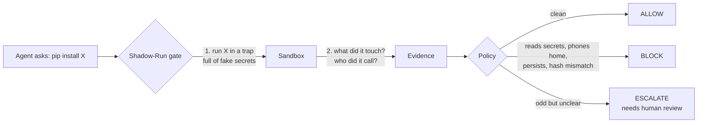
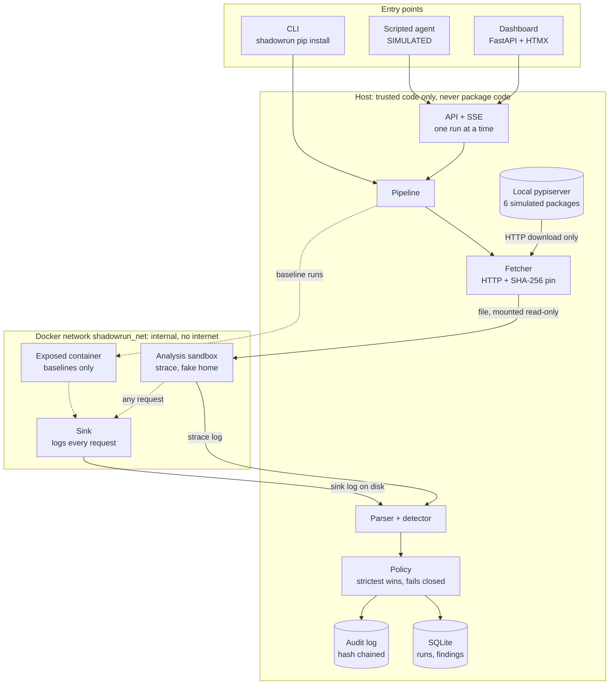
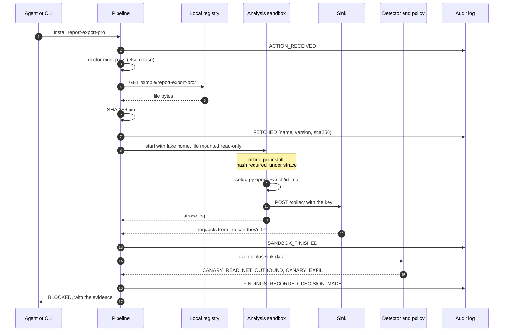
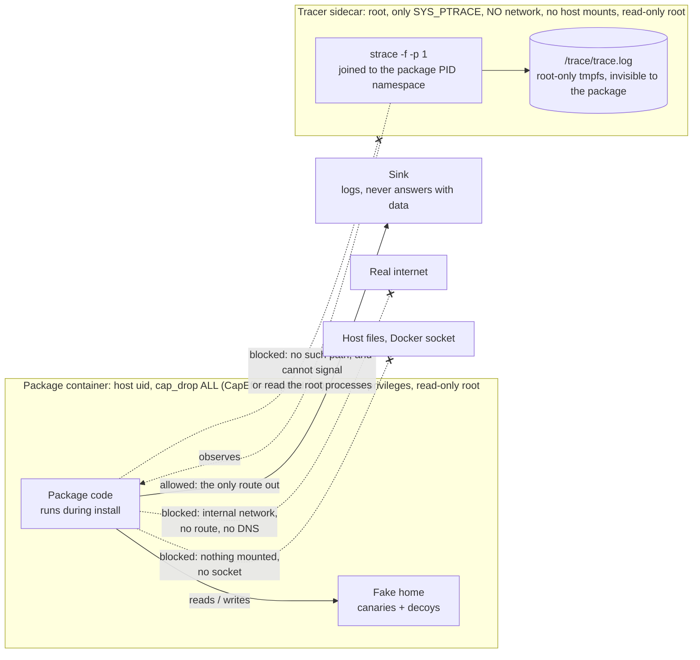
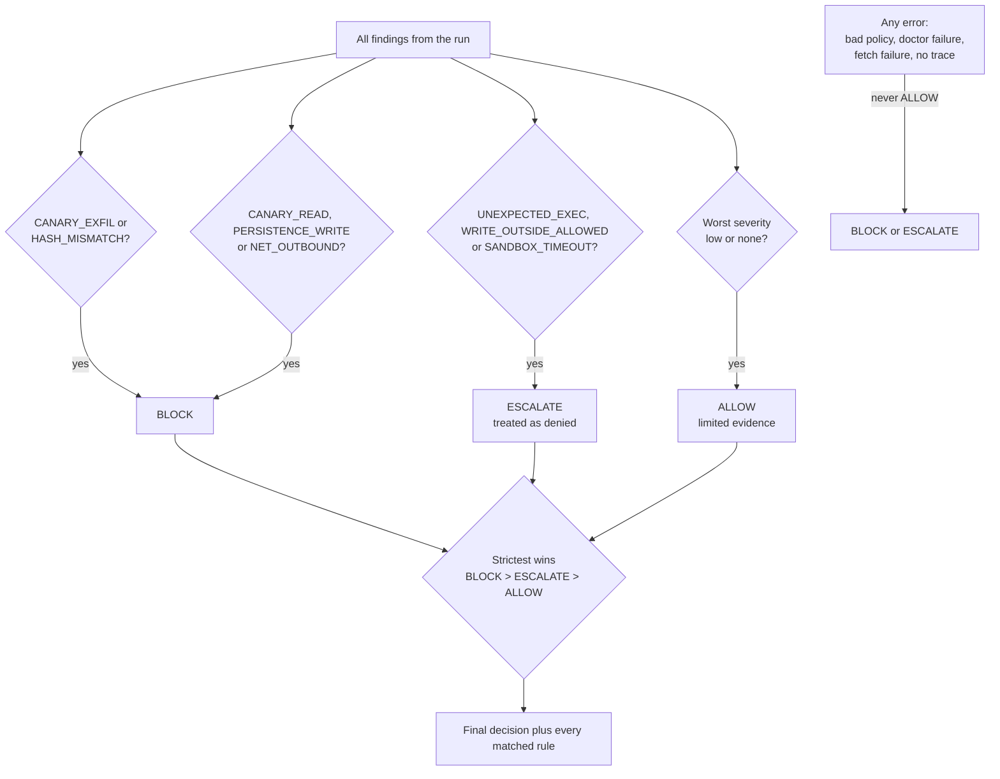
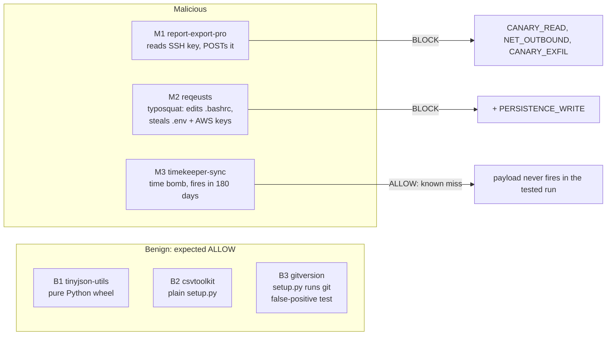
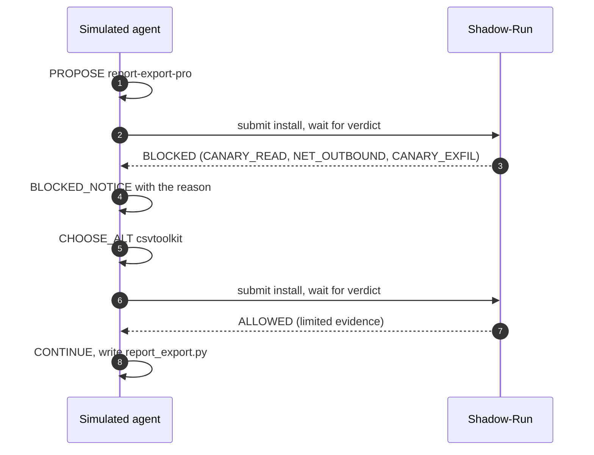
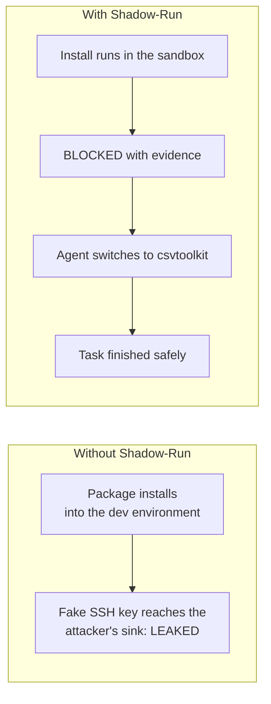
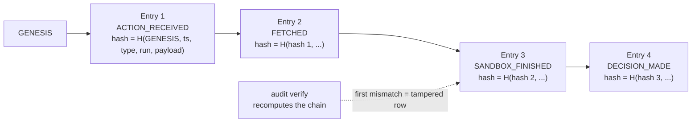
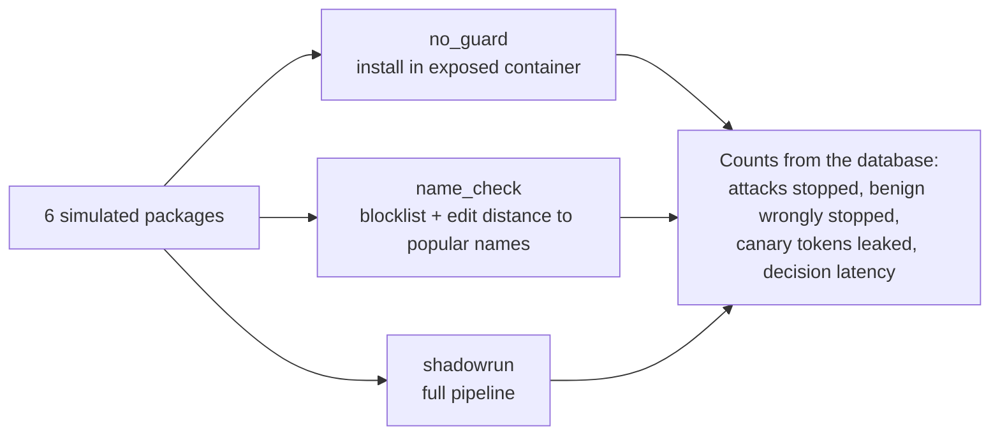

# Shadow-Run

**A behavioural verification gate for AI coding agents.** Before an agent's `pip install` is allowed, Shadow-Run
runs the package inside a locked-down sandbox full of fake secrets, watches what it actually does, and decides
**ALLOW**, **BLOCK** or **ESCALATE** with a deterministic policy. No LLM is in the decision path.

> **Honest claim.** Shadow-Run reduces the chance and the blast radius of a malicious install. It does not prove
> safety. Every number here comes from a small, self-written, simulated benchmark.
>
> Everything is a **simulation**: the packages, the agent and the secrets are fake, and payloads can only reach a
> sink container inside an internal Docker network. Nothing touches a real host.

## Quick start: from a fresh clone to the dashboard

About 10 minutes the first time (most of it is downloading Docker images). You need **Windows 11 with WSL2 and an
Ubuntu distro**, or any Linux machine with Docker. Every command below runs **inside the Ubuntu (Linux) terminal**, not
in PowerShell, unless a step says otherwise.

**Step 0. Get Ubuntu on WSL2** (skip if you already have it). In PowerShell, run `wsl --install -d Ubuntu`, reboot if
asked, then open "Ubuntu" from the Start menu and create your Linux user. Check with `wsl -l -v` that its VERSION is 2.

**Step 1. Install the tools** (Docker engine, Python venv, strace, git):

```bash
sudo apt-get update
sudo apt-get install -y docker.io python3-venv python3-pip strace git curl
sudo usermod -aG docker $USER
```

**Step 2. Reload your group and start Docker.** Close the Ubuntu window. In **PowerShell** run `wsl --shutdown`, then
open Ubuntu again and run:

```bash
sudo service docker start
docker run --rm hello-world
```

You should see "Hello from Docker!". (On WSL without systemd you need `sudo service docker start` after every restart
of WSL. Docker Desktop with WSL integration enabled for Ubuntu also works and needs no `service` command.)

**Step 3. Clone the repository.** The work is on the `security-fixes-and-redesign` branch (the repo has no `main` yet).
Keep it in your Linux home folder, not under `/mnt/c`:

```bash
git clone -b security-fixes-and-redesign https://github.com/harsshadmax/shadowrun2.0.git ~/shadowrun2.0
cd ~/shadowrun2.0
```

**Step 4. Create the Python environment and install:**

```bash
python3 -m venv .venv
source .venv/bin/activate
pip install -e .
```

**Step 5. Build the six simulated packages.** This only assembles files; it never runs their code:

```bash
python packages/build_all.py
```

Expected: `built 6 packages into .../packages/dist`.

**Step 6. Start the sandbox services.** This builds two small Docker images the first time (a few minutes), creates the
internal network, and starts the sink and a local package registry:

```bash
bash scripts/up.sh
```

Expected last line: `up: sink + pypiserver started`.

**Step 7. Check that the sandbox is safe to use.** Every line must say PASS or runs are refused:

```bash
python -m shadowrun.cli doctor
```

Expected: nine `[PASS]` lines and `DOCTOR: ALL PASS`.

**Step 8. Start the dashboard:**

```bash
python -m shadowrun.cli serve
```

Leave this terminal open. It prints nothing while it works.

**Step 9. Open the dashboard.** In your Windows browser go to **<http://127.0.0.1:8000>**. The header should show
"Doctor PASS" and the page is empty until you run a scan.

**Step 10. Try it.**

1. Press **Run scan** (top left), choose `M1 · report-export-pro`, press **Run**. Expect **BLOCKED** with
   `CANARY_READ`, `NET_OUTBOUND` and `CANARY_EXFIL` after about 5 seconds.
2. Run `B2 · csvtoolkit`. Expect **ALLOWED**.
3. Open the **Demo** tab in the sidebar and press **Start demo** to see the same install with and without the gate,
   and the simulated agent switching to a safe package.
4. Use **Sandbox health** (right side) to see the doctor result with its check id and time.

**To stop:** press `Ctrl+C` in the server terminal, then `bash scripts/down.sh`.
**To start again later:** open Ubuntu and run

```bash
cd ~/shadowrun2.0 && source .venv/bin/activate
sudo service docker start      # not needed with Docker Desktop
bash scripts/up.sh && python -m shadowrun.cli serve
```

**If something goes wrong**

| Symptom | Fix |
|---|---|
| `permission denied` talking to Docker | You skipped the `wsl --shutdown` in step 2, so your new group is not active yet. Do it and reopen Ubuntu. |
| `Cannot connect to the Docker daemon` | Run `sudo service docker start` (or start Docker Desktop). |
| `Address already in use` on port 8000 | Another server is running: `fuser -k 8000/tcp`, or start on another port with `python -m shadowrun.cli serve --port 8010`. |
| Doctor shows a `[FAIL]` line | Read its message. Usually `bash scripts/up.sh` was not run, or Docker is not running. Fix it and rerun `doctor`. Scans are refused until it passes. |
| Dashboard header says `Doctor UNKNOWN` or `STALE` | The status is older than 2 minutes or not checked yet. It re-checks itself when no scan is running; or press **Re-check now** in the Sandbox health panel. |
| Windows browser cannot open `127.0.0.1:8000` | The server listens on localhost only and relies on WSL's localhost forwarding. In PowerShell run `wsl --update` then `wsl --shutdown`, reopen Ubuntu and start again. |
| `pip install -e .` fails | Make sure the virtual environment is active (the prompt starts with `(.venv)`). |

Prefer the command line? `python -m shadowrun.cli pip install report-export-pro` runs one scan and exits with code 2
(BLOCK), 3 (needs review) or 0 (ALLOW). More commands are in [section 10](#10-setup-use-and-demo).


*Split-screen replay (terminal beside dashboard): [`evidence/split_screen_demo.gif`](evidence/split_screen_demo.gif),
assembled from real captured output, not a live screen recording. Everything in `evidence/` is described in
[`evidence/README.md`](evidence/README.md).*

## Contents

0. [Quick start: from a fresh clone to the dashboard](#quick-start-from-a-fresh-clone-to-the-dashboard)
1. [The problem and the idea](#1-the-problem-and-the-idea)
2. [The system at a glance](#2-the-system-at-a-glance)
3. [Anatomy of one scan](#3-anatomy-of-one-scan)
4. [Isolation: what the sandbox can and cannot reach](#4-isolation-what-the-sandbox-can-and-cannot-reach)
5. [What is detected and how it is decided](#5-what-is-detected-and-how-it-is-decided)
6. [The simulated attacks](#6-the-simulated-attacks)
7. [The agent story](#7-the-agent-story)
8. [Audit trail](#8-audit-trail)
9. [Benchmark](#9-benchmark)
10. [Setup, use and demo](#10-setup-use-and-demo)
11. [Known gaps](#11-known-gaps)
12. [Repository map and safety rules](#12-repository-map-and-safety-rules)
13. [Contributors](#13-contributors)

---

## 1. The problem and the idea

AI coding agents install packages on their own. A name check or a vulnerability list will not catch a package whose
`setup.py` quietly reads `~/.ssh/id_rsa` the moment it is installed. Shadow-Run looks at **behaviour** instead of
reputation.



The trap works because the secrets are **canaries**: unique, fake values (`CANARY-<run>-ssh`). If one ever shows up
in the sink's log, we know exactly which file was stolen and sent.

---

## 2. The system at a glance



| Layer | Job | Code |
|---|---|---|
| Fetcher | Download over HTTP, hash it. **Never** `pip download` (it can run `setup.py` on the host). | `shadowrun/fetcher.py` |
| Sandbox | Hardened container: read-only root, non-root user, no capabilities, no Docker socket, memory/CPU/pid limits, 30 s timeout. | `shadowrun/sandbox.py` |
| Canaries | Per-run fake home with alarming canaries and quiet decoys. | `shadowrun/canary.py` |
| Detector | Parse strace and sink logs, fire rules on **attempts**, not outcomes. | `shadowrun/monitor.py`, `detector.py` |
| Policy | YAML rules, strictest decision wins, any error denies. | `shadowrun/policy.py`, `policies/default.yaml` |
| Storage | Runs, findings, agent events, benchmark rows, hash-chained audit. | `shadowrun/db.py`, `audit.py` |
| Doctor | Self-test that gates every run. | `shadowrun/doctor.py` |

---

## 3. Anatomy of one scan

What happens between "install this" and the verdict (about 5 seconds once the sandbox is warm; the tracer runs in a sidecar container, see section 9 for the timing breakdown).



Phases are timed individually (fetch, hash, sandbox, analyze, decide) and shown live in the dashboard.

---

## 4. Isolation: what the sandbox can and cannot reach

The trap only works if nothing can escape it. `shadowrun doctor` proves each arrow below before every run.

Two containers share one PID namespace. The one that runs untrusted code has **no root and no capabilities**; the only
root component is a **network-less tracer sidecar** that can do exactly one privileged thing, ptrace.



| Control | Setting | Checked by doctor |
|---|---|---|
| Network | `shadowrun_net` is `internal=True` | Internal flag, `1.1.1.1` unreachable, `example.com` does not resolve |
| Sink reachable | Sandbox can POST to `sink:9000` only | Round trip logged by the sink |
| Observation | `strace -f -p 1` from the sidecar, with a syscall list built from the parser's groups | Records a canary `openat` and a `connect` |
| Syscall coverage | Opens (`open`, `openat`, `openat2`, `creat`), exec (`execve`, `execveat`), network (`connect`, `sendto`, `sendmsg`, `sendmmsg`), path changes (`rename*`, `link*`, `symlink*`, `unlink*`, `mkdir*`, `chmod*`, `chown*`, `truncate`, `mknod*`), and evasion attempts (`memfd_create`, `io_uring_*`, `ptrace`, `mount`, `unshare`, `setns`, `bpf`, `kill` aimed at init, ...) | Doctor check 9 runs a probe that uses the bypass calls and requires them to be recorded **and** detected |
| Filesystem | Read-only root, `/tmp` and `/work` as tmpfs, fake home writable | Write to `/etc` fails, `/tmp` is executable |
| Privileges, package | Host uid, `cap_drop ALL`, `no-new-privileges`, no root process | `CapEff` and `CapBnd` are zero, uid is not 0 |
| Privileges, tracer | Root with **only** `SYS_PTRACE` (no `SETUID`, no `SETGID`), no network, no host mounts, read-only root | Container settings asserted in `tests/test_evidence_isolation.py` |
| Evidence | Trace lives in the sidecar's root-only tmpfs, a different mount namespace: the package cannot see, open, truncate, replace or list it, or signal the tracer | Attacks on the tracer's root processes all denied, trace hash verified |
| Limits | 512 MB, 1 CPU, 128 pids, 30 s timeout, containers always removed | Timeout test |

If any doctor check fails, **runs are refused** (fail closed).

**Residual risk.** The tracer is root with `CAP_SYS_PTRACE` in a PID namespace it shares with the package container. It
has no network, no host mounts and no other capability, but a kernel or container-runtime vulnerability reachable
through ptrace could still turn it into a host compromise. Rootless Docker, user-namespace remapping or
gVisor/Firecracker would shrink that risk and are on the roadmap. A package can also still force a denied verdict (for
example by exhausting the trace size cap); it can never force an allow. The design is documented at the top of
[`shadowrun/sandbox.py`](shadowrun/sandbox.py) and in `CLAUDE.md`.

### How the evidence is protected, collected and trusted

Originally the trace was written to a folder the package could also write to, so a hostile `setup.py` could have erased
its own evidence. Then the tracer ran as root inside the package's container and dropped privileges with `setuid`
(which needed `SETUID`/`SETGID` and a root PID 1). Now the package container has no root at all, and the tracer is a
separate sidecar. The package's init waits for a `go` file in a read-only mount, so **the tracer is attached before a
single line of package code runs**.

```mermaid
sequenceDiagram
    autonumber
    participant Host as Host pipeline
    participant Pkg as Package container (no caps)
    participant Tr as Tracer sidecar (SYS_PTRACE only)
    participant Det as Detector

    Host->>Pkg: start; init waits for /ctl/go (read-only mount)
    Host->>Tr: start; strace -f -p 1 in the package PID namespace
    Host->>Tr: wait until TracerPid of init is set
    Host->>Pkg: create /ctl/go
    Pkg->>Pkg: sh -c install command, traced from its first instruction
    Pkg->>Pkg: tries to wipe the trace or kill the tracer
    Note over Pkg: no such path; EPERM on every signal; the attempts are recorded
    Pkg->>Pkg: prints SHADOWRUN_RC, init parks itself in cat
    Host->>Tr: wait for cat and no other non-root process, then SIGINT strace
    Host->>Tr: docker exec: stat, sha256, cat (root)
    Host->>Host: owner 0:0, mode 600, size and hash must match
    Host->>Det: verified trace
    Det->>Det: complete? (init ran cat, every traced process exited, no unresumed calls, no cut-off strings, pip seen)
    Det-->>Host: findings, or INCOMPLETE_TRACE / EVIDENCE_UNAVAILABLE / EVIDENCE_TAMPERED
```

Missing or partial evidence is never treated as "nothing happened": it produces an **indeterminate**, denied verdict
(`ESCALATE`, shown as "Indeterminate"). Evidence that fails its integrity checks is a **BLOCK**.

### Registry allowlist and sandbox health

- **Downloads:** the fetcher only talks to the origin(s) in `config.REGISTRY_ALLOWLIST` (default: the local
  pypiserver). Links inside registry pages and redirect targets go through the same exact scheme/host/port check, hosts
  are resolved once and the connection is pinned to that validated IP (no DNS rebinding), and non-public addresses are
  refused unless the allowlist entry itself is a loopback or private literal.
- **Health:** one shared status (`shadowrun/health.py`) feeds the gate, the header pill and the Sandbox health panel.
  Every check has an id and time, each run records which check gated it, and the dashboard shows **PASS, FAIL, STALE
  or UNKNOWN** explicitly. A doctor check never runs concurrently with a scan.

---

## 5. What is detected and how it is decided

### Detector rules

| Rule | Fires when | Severity |
|---|---|---|
| `CANARY_EXFIL` | A canary token for this run appears in the sink's data | critical |
| `HASH_MISMATCH` | pip rejects the file against the pinned SHA-256 | critical |
| `CANARY_READ` | Package code opens a canary file (even if the open fails) | high |
| `NET_OUTBOUND` | Any `connect`, `sendto`, `sendmsg` or `sendmmsg` with a destination other than loopback and the resolver (the install is offline, so none is legitimate; datagrams need no `connect`) | high |
| `EVASION_SYSCALL` | An attempt at `memfd_create`, `io_uring_*`, `ptrace`, `mount`, `unshare`, `setns`, `bpf`, `chroot`, `init_module`, `keyctl`, executing a file descriptor, or signalling the sandbox init. Counts even when the kernel or seccomp refuses it | high |
| `PERSISTENCE_WRITE` | Write to `.bashrc`, `.profile`, autostart, cron, `authorized_keys` | high |
| `UNEXPECTED_EXEC` | `execve` of a binary outside the allowed list | medium |
| `WRITE_OUTSIDE_ALLOWED` | Write outside `/work`, `/tmp`, `/home/sandbox/.cache` | medium |
| `SANDBOX_TIMEOUT` | Run exceeded the timeout | medium |
| `EVIDENCE_TAMPERED` | Trace ownership, mode, size or hash failed verification | critical |
| `EVIDENCE_UNAVAILABLE` | The trace could not be collected (container gone, file missing, too large) | medium |
| `INCOMPLETE_TRACE` | Empty, unparseable, truncated or cut-short trace; cut-off strings; pip never seen executing | medium |
| `INSTALL_FAILED` | pip failed for another reason | low |

Reading a **decoy** (`.gitconfig`, `.bash_history`, ...) is never a finding, so a benign `git` call does not trigger
the gate. Detection is calibrated so that pip's own activity yields zero findings on a real wheel and a real sdist.

### From findings to a verdict



All matching rules are recorded, and an ALLOW always carries the words *"no suspicious behaviour in the tested run
(limited evidence)"*.

---

## 6. The simulated attacks

Six fixtures live in `packages/src`. They are assembled **by hand** (`shadowrun/sdist_tool.py`), because
`python -m build` would execute `setup.py` on your machine. Every file starts with
`# SIMULATED TEST FIXTURE. INERT OUTSIDE THE SHADOW-RUN SANDBOX.`



M3 is a **known false negative**: a clock-triggered payload does not run now. The planned fix is a deep mode that
shifts the sandbox clock.

---

## 7. The agent story

The simulated agent's task is *"Add CSV export to the report module."* Without the gate it would install the
stealer. With the gate it is stopped, reads the reason, and picks a safe alternative.



The dashboard's **Split-screen demo** shows both worlds side by side:



---

## 8. Audit trail

Every pipeline step appends an entry to an **insert-only** table. Each entry's hash covers the previous entry's hash,
so editing or deleting any row breaks every hash after it.



Event types: `ACTION_RECEIVED`, `FETCHED`, `SANDBOX_STARTED`, `SANDBOX_FINISHED`, `FINDINGS_RECORDED`,
`DECISION_MADE`, `EVAL_STARTED`, `EVAL_FINISHED`. The dashboard's **Verify chain** button and
`shadowrun audit verify` both run the check. Limit: a chain proves *edits* happened, not that the latest rows were
never truncated.

---

## 9. Benchmark

Three setups run over the six fixtures, three repeats each, after one discarded warm-up (`eval/results/results.md`).



| Setup | Attacks stopped | Benign wrongly stopped | Canary tokens leaked | Median decision | Max decision |
|---|---|---|---|---|---|
| no_guard | 0 of 3 | 0 of 3 | 3 | n/a | n/a |
| name_check | 1 of 3 (the typosquat) | 0 of 3 | 1 | n/a | n/a |
| shadowrun | 2 of 3 (the time bomb slips through) | 0 of 3 | 0 | 5.3 s | 5.7 s |

> Small demo benchmark: 6 self-written, simulated packages, 3 runs each. It shows the mechanism works on simulated
> attacks, not real-world detection rates. Latency is dominated by container start and install time and was measured
> on this machine.

Reading the table honestly: Shadow-Run's `0` leaked tokens is true **by construction**, because it never installs
outside its sandbox. The attack it missed is M3. The name check only caught the one attack with a lookalike name.

**The hardening has a latency cost, and this is its measurement.** Detection results are identical to the original code
(2 of 3 attacks stopped, 0 benign stopped), but the median decision time went from **2.6 s** (original, max 3.5 s) to
**5.3 s** (max 5.7 s). Profiling one scan (isolated, warm; wheel / sdist) shows where it goes:

| Stage | Wheel | Sdist | Note |
|---|---|---|---|
| Package container start | 0.3 s | 0.3 s | |
| Tracer sidecar start | 0.2 s | 0.2 s | a second container |
| Attach, stop tracer, collect trace | 0.4 s | 0.4 s | `docker exec` round trips |
| Traced install | 1.7 s | 3.3 s | an untraced sdist install takes 1.9 s in one container |
| Teardown and bookkeeping | ~0.4 s | ~0.4 s | |

The traced install is the largest part: `strace --seccomp-bpf`, which made tracing cheap before, is **refused when
attaching to a running process** (`strace: --seccomp-bpf is not enabled for processes attached with -p`, checked on
strace 6.13), so the tracer now stops on every syscall of the traced processes. I tried faster polling, parallel
teardown and disabling bytecode writes; together they were within measurement noise. The trade is deliberate: roughly
2x latency for a package container with no root and no capabilities and a tracer that has one capability and no
network. These runs used a warm doctor status (`gate` ≈ 0 s); a first run after the 120 s status expires also pays for
a full doctor check of about 10 s.

The validation behind these numbers names the exact source it tested: commit
`6783e23ed84cebda7e62fb15a4e3f1a7a593f32b`, source hash `0da2af7e…1d89` (`bash scripts/source_hash.sh` on that commit
prints the same value), clean working tree, source unchanged during the run. Raw output (environment, doctor, pytest,
benchmark, audit verify, exit codes) is in [`evidence/validation.log`](evidence/validation.log). The same steps run in
GitHub Actions (`.github/workflows/ci.yml`) so anyone can reproduce them without trusting that log.

---

## 10. Setup, use and demo

### Setup (Windows 11 + WSL2)

The step-by-step version is the [Quick start](#quick-start-from-a-fresh-clone-to-the-dashboard) at the top. The repo
must live in the WSL filesystem (`~/shadowrun2.0`), not under `/mnt/c`.

```bash
# inside Ubuntu on WSL2
sudo apt-get update && sudo apt-get install -y docker.io python3-venv python3-pip strace git
sudo usermod -aG docker $USER      # then: wsl --shutdown (from PowerShell) and reopen Ubuntu
sudo service docker start          # WSL without systemd needs this after each WSL restart

git clone -b security-fixes-and-redesign https://github.com/harsshadmax/shadowrun2.0.git ~/shadowrun2.0 && cd ~/shadowrun2.0
python3 -m venv .venv && . .venv/bin/activate
pip install -e .
bash scripts/vendor_assets.sh      # only if dashboard/static/vendor is missing (needs internet once)
python packages/build_all.py       # builds the six simulated packages into packages/dist
bash scripts/up.sh                 # images, internal network, sink, pypiserver
python -m shadowrun.cli doctor     # every check must PASS or runs are refused
```

Docker Desktop with WSL integration also works.

### Use

```bash
python -m shadowrun.cli pip install report-export-pro   # exit 2 = BLOCK, 3 = ESCALATE, 0 = ALLOW
python -m shadowrun.cli serve                           # dashboard at http://127.0.0.1:8000
python -m agent.scripted_agent                          # simulated agent against a running server
python -m shadowrun.cli eval --repeats 3                # benchmark -> eval/results/
python -m shadowrun.cli audit verify                    # recompute the audit hash chain
python -m shadowrun.cli reset                           # clear runs, sink log, agent events (audit log kept)
python -m eval.record_run                               # save one full run as a stage backup
python -m pytest                                        # sandbox tests skip if the services are down
```

### The dashboard

| Panel | Shows | Source |
|---|---|---|
| Stat cards | Total scans, blocked, allowed | `runs` table |
| Detection matrix | Which rules fired for which package (Findings tab) or decisions per package | `findings`, `runs` |
| Run detail | Timeline per phase, evidence, decision time for the selected run | `runs.phase_ms_json` |
| Isolation | Layout plus the doctor's four sandbox checks | `doctor` |
| Scripted agent | Last transcript lines and a play button | `agent_events` |
| Recent activity | Filter tabs, paging, click a row for its detail | `runs` |
| Demo page | Split-screen demo, benchmark table and chart, audit "Verify chain" | `eval/results/latest.json`, `audit` |

### 5-minute demo script

1. Open `/demo`. The header shows doctor green and **SIMULATED SCENARIOS ONLY**.
2. Press **Start demo**. The simulated agent proposes `report-export-pro`.
3. Left, no guard: the fake SSH key's canary token reaches the sink, shown in red.
4. Right, Shadow-Run: `CANARY_READ`, `NET_OUTBOUND`, `CANARY_EXFIL`, verdict **BLOCKED** with measured seconds. The agent reads the reason, switches to `csvtoolkit`, and finishes.
5. On the overview, **Run scan** a benign package (B1 to B3): it passes unchanged.
6. Run **M3 `timekeeper-sync`**: it is allowed. Say this is the known miss and that a clock-shifting deep mode is the next step.
7. Show the benchmark table with counts, latency and the disclaimer.
8. Press **Verify chain** in the audit panel.
9. Close with: "Shadow-Run reduces the chance and the blast radius. It does not prove safety."

Backup if Docker misbehaves on stage: `eval/results/results.md` and `eval/results/recorded_run.md`.

---

## 11. Known gaps

**Not built (roadmap):** MODIFY decisions, quick/deep modes and the verdict cache, other evasive packages, replay,
approval UI, LLM explainer, Claude Code hook, shell commands, re-scan, a contained "real install" step, npm, MCP
server, gVisor or Firecracker.

**Read results with these in mind:**

- **M3 (time bomb) is allowed.** A clock-triggered payload does not fire in the tested run. Known false negative.
- **ALLOW is not a safety proof.** Only behaviour during one offline install in one sandbox is observed.
- **Nothing is installed outside the sandbox**, so "leaked tokens: 0" for Shadow-Run is by construction.
- **What is not traced cannot be detected.** The tracer collects the syscall groups in `shadowrun/monitor.py` (opens,
  exec, network sends, path changes, evasion attempts). Anything outside them is invisible: for example `read`/`write`
  contents, `socket` options, `bind`, and I/O performed through `io_uring` (Docker's default seccomp profile denies
  `io_uring` here, and attempts are flagged, but that protection depends on the runtime's profile). `AF_UNIX`
  connects are parsed but not flagged. Symlinks are not resolved. Signals are flagged only when aimed at the sandbox
  init or at every process.
- `strace --seccomp-bpf` cannot be used when attaching to a running process, so the tracer stops on every syscall of
  the traced processes. That roughly doubled decision time (2.6 s to 5.3 s median, see section 9) and would hurt more on
  syscall-heavy packages; the 30 s run timeout then ends in a denied verdict, never an allow.
- The tracer sidecar is root with `CAP_SYS_PTRACE` (see the residual-risk note in section 4).
- `sandbox` time is container start plus install, measured together. A first scan after an idle period also
  includes the doctor self-test, so it shows a longer decision time.
- Fixtures are assembled by hand because building them would run `setup.py` on the host.
- The dashboard is dark-only.

Acceptance status for all 17 blueprint items is in [`ACCEPTANCE.md`](ACCEPTANCE.md).

---

## 12. Repository map and safety rules

```
shadowrun/        sandbox, canary, monitor, detector, policy, fetcher, pipeline, db, audit, doctor, api, ui, stats, cli
sink/  docker/    sink service and the sandbox image
packages/         simulated fixtures (src) and build_all.py
policies/         default.yaml (rules, allowed paths, pip baseline)
agent/            scripted_agent.py (SIMULATED)
eval/             baselines, run_eval, record_run, results/
dashboard/        Jinja templates, CSS, JS, vendored htmx + Chart.js
scripts/          up/down, vendor_assets, demo helpers
tests/            unit, detector fixtures, API, dashboard, end-to-end through the real sandbox
```

**Safety rules.** Test packages are inert and labelled SIMULATED; payloads only read fake files and only send to
`sink`; `shadowrun_net` is internal and `doctor` gates every run (fail closed); containers are non-root with
`cap_drop ALL` (plus `SYS_PTRACE` for analysis only), `no-new-privileges`, resource limits and a hard timeout, and are
always removed; no Docker socket in containers; all templates are autoescaped and the dashboard JS never builds HTML
from data; any error ends in BLOCK or ESCALATE, never ALLOW.

---

## 13. Contributors

| Contributor | Role |
|---|---|
| [@harsshadmax](https://github.com/harsshadmax) | Project owner and author |

See [`CONTRIBUTORS.md`](CONTRIBUTORS.md).
